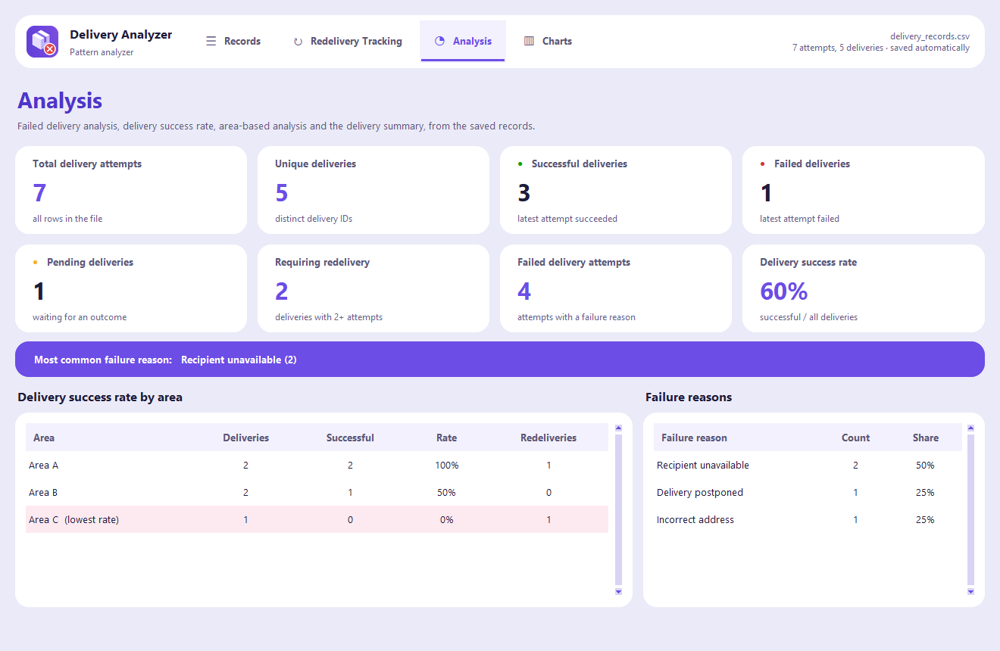
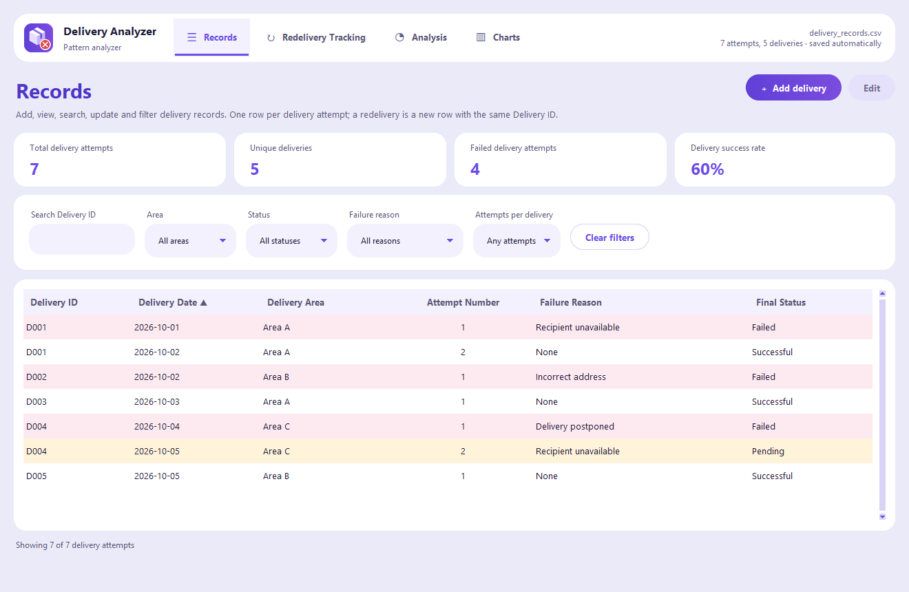
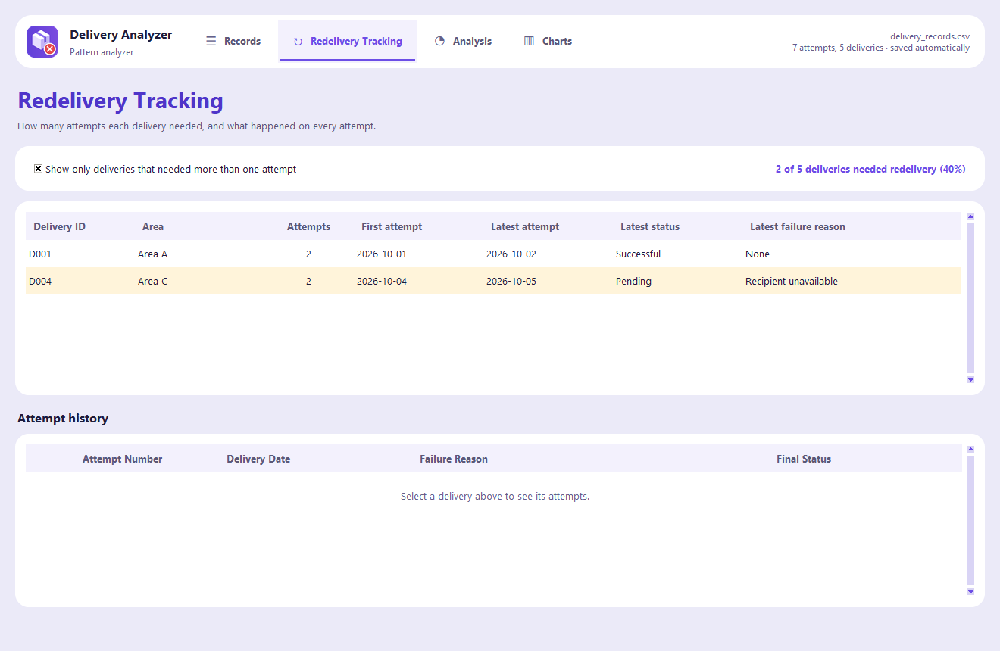
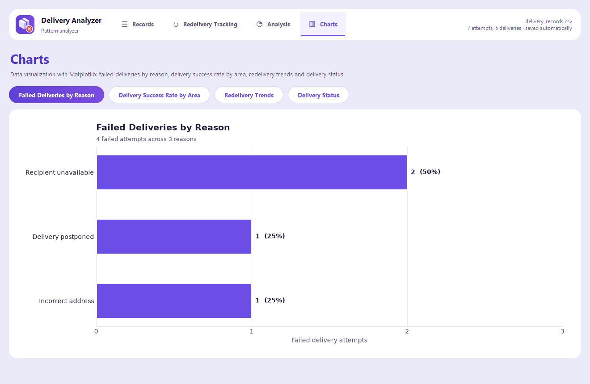

# Failed Delivery & Redelivery Pattern Analyzer


**Finds out why deliveries fail, which areas struggle, and which parcels needed a second trip.**

Every delivery attempt is recorded; the program turns the records into a success rate, success
rate by area, the most common failure reasons, redelivery tracking and trend charts.

Built by **Ian Karvey L. Manimtim** — 2026 · Python · Tkinter · Matplotlib · CSV · PyInstaller

**▶ Try it in your browser:** [karveyportfolio.vercel.app/projects/failed-delivery-analyzer](https://karveyportfolio.vercel.app/projects/failed-delivery-analyzer/)
(an interactive recreation with the GUI and terminal views)



## Screenshots

The desktop app running on the sample records in `sample_data/`.

| Records — add, search and filter every attempt | Redelivery tracking — deliveries that needed a second trip |
|---|---|
|  |  |



## Two interfaces, one engine

| Folder | What it is |
|---|---|
| [`Failed Delivery Analyzer/`](Failed%20Delivery%20Analyzer/) | The desktop app (Tkinter) with Records, Redelivery Tracking, Analysis and Charts tabs — plus a text-menu console version. Includes **79 automated tests**. |
| [`Failed Delivery Analyzer - Terminal/`](Failed%20Delivery%20Analyzer%20-%20Terminal/) | A stand-alone, menu-driven terminal program with the same 12 features. |

Both share the same rules and calculations (`delivery_core.py`), so they always give the same numbers:

- a successful attempt has no failure reason; a failed attempt must have one;
- a delivery that already succeeded cannot get more attempts;
- adding a redelivery reuses the Delivery ID and fills in the area and next attempt number.

## Run it

```bash
pip install -r requirements.txt
python main.py                      # in either folder
python -m unittest test_delivery_analyzer   # in "Failed Delivery Analyzer"
```

Each folder's README explains every feature in detail. The records in `sample_data/` are sample
data, not real deliveries. The ready-to-run Windows build is published under **Releases**.

---

© 2026 Ian Karvey L. Manimtim
